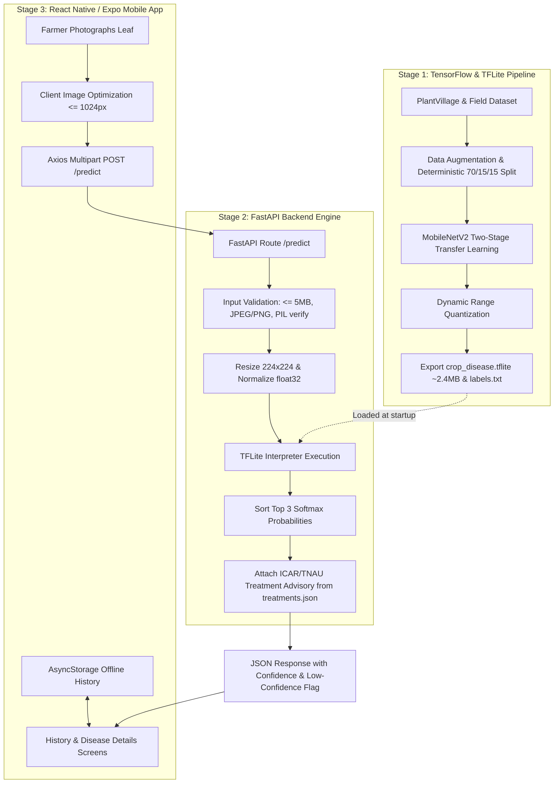

# Smart Crop Disease Detector

An end-to-end AI-powered mobile and backend system designed for smallholder farmers to photograph crop leaves and receive instant disease diagnoses, confidence scores, and ICAR/TNAU agricultural management guidance.

---

## 🏛️ System Architecture



---

## 📁 Repository Directory Structure

```text
Smart Crop Disease Detector/
│
├── backend/                        # Stage 2: Production FastAPI Backend
│   ├── main.py                     # Lifespan TFLite loader, /health, /predict endpoints
│   ├── treatments.json             # ICAR/TNAU symptoms, treatment & prevention database
│   ├── requirements.txt            # Backend dependencies
│   └── tests/                      # Automated test suites
│       ├── test_backend.py         # Pytest coverage for all endpoints and error cases
│       ├── test_api.py             # Acceptance integration tests (acceptance criteria)
│       └── e2e_test.py             # End-to-end verification (clear leaf vs blurry vs non-leaf)
│
├── mobile/                         # Stage 3: React Native (Expo) Mobile & Web App
│   ├── App.js                      # Root navigation stack & green/earth theme headers
│   ├── app.json                    # Expo project configuration & permissions
│   ├── package.json                # React Native, Expo, React Navigation dependencies
│   └── src/
│       ├── config.js               # Central API_URL with dynamic Web/Mobile host detection
│       ├── strings.js              # Centralized user-facing strings (ready for i18n)
│       ├── theme.js                # High-contrast agricultural green/earth design tokens
│       ├── api.js                  # uploadLeaf() with Axios & friendly error handling
│       ├── utils/                  # Image compression, name formatting, AsyncStorage
│       ├── components/             # Large touch buttons, confidence bars, disclaimer banners
│       └── screens/                # HomeScreen, ResultScreen, HistoryScreen, DiseaseDetails
│
├── ml/                             # Stage 1: Machine Learning Training Pipeline
│   ├── generate_fake_dataset.py    # Synthetic dataset generator for code verification
│   ├── requirements.txt            # ML dependencies (TensorFlow, scikit-learn, etc.)
│   └── train_and_export_tflite.py  # Two-stage training, evaluation & quantized TFLite export
│
├── dataset/                        # Leaf photos categorized by disease folders
│   ├── Potato___Late_blight/
│   ├── Potato___healthy/
│   ├── Tomato___Early_blight/
│   └── Tomato___healthy/
│
├── output/                         # Exported model artifacts & evaluation graphs
│   ├── crop_disease.tflite         # Quantized MobileNetV2 model (~2.4 MB)
│   ├── labels.txt                  # Output class labels matching softmax indices
│   ├── labels.json                 # Label indices & model specifications
│   ├── training_history.png        # Training vs. validation accuracy and loss curves
│   └── confusion_matrix.png        # Test set evaluation confusion matrix
│
├── docs/                           # Documentation, Technical Guides & Viva QA
│   ├── backend_architecture.md     # Detailed backend API documentation
│   ├── test_cases.md               # Manual test cases checklist for project report
│   └── VIVA_QA.md                  # 15 Examination & Viva technical Q&A pairs
│
├── .gitignore                      # Git ignore rules for Python, Node & Expo
├── main.py                         # Root entrypoint launcher (forwards to backend.main:app)
├── requirements.txt                # Unified dependencies
└── README.md                       # Master project overview
```

---

## 🚀 Setup & Execution Guide

### 1. Prerequisites
- **Python 3.10+** (Python 3.11 recommended)
- **Node.js 18+** & **npm**
- **Expo Go App** installed on your Android device (from Google Play Store)

---

### 2. Stage 1: Machine Learning Model Pipeline

```powershell
# 1. Activate virtual environment
.venv\Scripts\Activate.ps1

# 2. Run the end-to-end training and export pipeline
python ml/train_and_export_tflite.py --dataset_dir dataset --epochs_stage1 10 --epochs_stage2 10

# 3. Test single image inference with the generated TFLite model:
python ml/train_and_export_tflite.py --test "dataset/Tomato___Early_blight/tomato.jpg"
```

#### Training in Google Colab (Free T4 GPU ~3-5 minutes)
1. In Google Colab: **Runtime ➔ Change runtime type ➔ Hardware accelerator: T4 GPU**.
2. Mount Google Drive and install requirements:
   ```bash
   !pip install -r ml/requirements.txt
   ```
3. Run training:
   ```bash
   !python ml/train_and_export_tflite.py --dataset_dir "/content/drive/MyDrive/dataset" --epochs_stage1 15 --epochs_stage2 15
   ```
4. Download the generated `crop_disease.tflite` and `labels.txt` into your local `output/` directory.

---

### 3. Stage 2: Backend API Server

```powershell
# 1. Install backend dependencies
pip install -r requirements.txt

# 2. Start the FastAPI server (accessible across local network)
uvicorn main:app --host 0.0.0.0 --port 8000 --reload
```

- **Interactive Swagger Docs**: [http://127.0.0.1:8000/docs](http://127.0.0.1:8000/docs)
- **Health Check**: `GET http://127.0.0.1:8000/health`
- **Run Pytest Suite**:
  ```powershell
  pytest backend/tests/test_backend.py -v
  ```
- **Run End-to-End Test (Clear, Blurry, Non-leaf)**:
  ```powershell
  python e2e_test.py
  ```

---

### 4. Stage 3: Mobile App (React Native / Expo)

#### Step 1: Find Laptop's Local IP Address
In Windows PowerShell, run:
```powershell
ipconfig
```
Find the **IPv4 Address** (e.g. `192.168.1.10`).

#### Step 2: Configure API URL
Open [mobile/src/config.js](file:///d:/Smart%20Crop%20Disease%20Detector/mobile/src/config.js) and verify:
```javascript
export const CONFIG = {
  API_URL: 'http://192.168.1.10:8000', // Your laptop IP
  USE_MOCK_API: false,                  // Set true to test offline without backend
  ...
};
```

#### Step 3: Start Expo & Connect Phone
```powershell
cd mobile
npm start
```
1. Open the **Expo Go** app on your Android phone (connected to the same Wi-Fi).
2. Tap **Scan QR code** and point at your terminal.
3. The app loads and is ready to photograph and diagnose leaves!

---

## ☁️ Cloud Deployment (Render & Railway)

### Deploying on Railway
1. Push this repository to GitHub.
2. Sign in to [railway.app](https://railway.app) ➔ **New Project** ➔ **Deploy from GitHub repo**.
3. Set the **Start Command**:
   ```bash
   uvicorn main:app --host 0.0.0.0 --port $PORT
   ```
4. Copy the generated Railway public URL and paste it into `mobile/src/config.js`.

### Deploying on Render
1. Create a **New Web Service** on [render.com](https://render.com) linked to your GitHub repo.
2. Settings:
   - **Build Command**: `pip install -r requirements.txt`
   - **Start Command**: `uvicorn main:app --host 0.0.0.0 --port $PORT`
3. Deploy and update `API_URL` in `mobile/src/config.js` with your Render HTTPS domain.

---

## 🔧 Troubleshooting Common Issues

| Issue | Cause | Solution |
| :--- | :--- | :--- |
| **Phone cannot connect to laptop** | Windows Defender Firewall blocking port `8000` or `8081`. | Run PowerShell as Admin: `netsh advfirewall firewall add rule name="FastAPI" dir=in action=allow protocol=TCP localport=8000` or use `npx expo start --tunnel`. |
| **Phone shows raw JSON in browser** | QR code scanned using default camera app instead of Expo Go. | Open **Expo Go app** first, then tap **Scan QR code** inside the app. |
| **"Model output dimension mismatch"** | Number of lines in `labels.txt` does not match TFLite output neurons. | Re-run `python ml/train_and_export_tflite.py` to regenerate matching model and labels. |
| **Upload rejected with 400** | File is larger than 5 MB or not a JPEG/PNG. | Ensure camera photo is compressed using client-side `optimizeLeafImage()` before uploading. |

---

## 🔮 Future Scope: Offline On-Device Inference Roadmap

Currently, inference is executed via the lightweight FastAPI backend. To enable **100% offline edge inference** directly on the phone without internet access:
1. **Library**: Integrate `react-native-fast-tflite` (native C++ TFLite bindings for iOS/Android).
2. **Asset Bundling**: Bundle `crop_disease.tflite` (~2.4 MB) directly into the app assets directory.
3. **Execution**: Pass the camera frame or photo buffer directly to `useTensorflowModel()` on-device.
4. **Fallback**: Implement a dual-mode engine: run locally if offline, or query the backend if online to access updated treatment databases.
